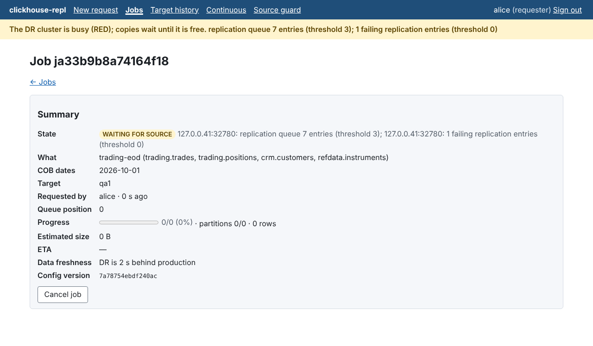
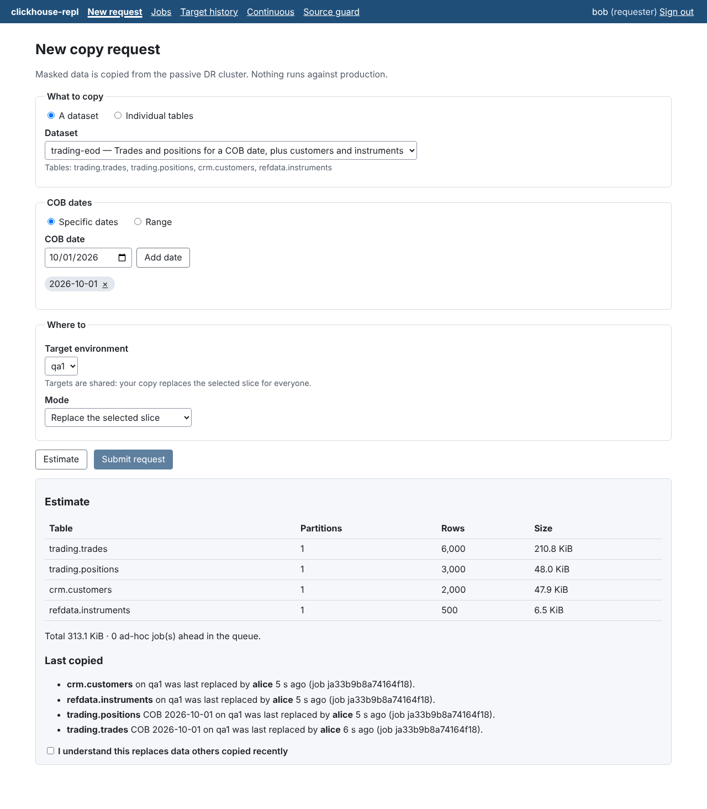

# clickhouse-repl

A tool for copying data from a production ClickHouse cluster into non-production
environments (QA, UAT, perf), with consistent masking of sensitive columns.

- **Configured replication**: a list of databases and tables, with masking policies per column.
- **Consistent masking**: deterministic, keyed masking, so the same value masks the same way across tables and runs and joins still work.
- **Continuous mode**: keeps a configured set of tables near-real-time in sync.
- **Ad-hoc mode**: QA users request a table or dataset for a COB date from a web portal, and the job runs in the background.
- **Production first**: reads come only from the passive DR datacentre — the active DC is never contacted. A Source Guard admits reads only while DR replication is healthy, pre-empts them when it falls behind, stops immediately if DR becomes active, and fails closed.

Status: every milestone of the [plan](docs/PLAN.md) is implemented (M0–M8). Items that need people or a
staging environment are listed there as open: the staging load test and sign-off, the failover drill,
the pen test, and the run against a real Fortanix DSM tenant.

Docs:

- [Design specification](docs/SPEC.md)
- [Runbook](docs/runbook.md) · [Load test](docs/loadtest.md) · [Security review](docs/security-review.md) · [Dependency and image scanning](SECURITY.md)
- [Implementation plan](docs/PLAN.md)
- [Example configuration](docs/examples/replicator.yaml)

## Demo

One command starts a small but complete setup in Docker:
- a "prod" ClickHouse replica and its "DR" replica (ReplicatedMergeTree through Keeper);
- a `qa1` target, Postgres, a development-only OIDC provider and the app.

It then seeds fictional trading data on prod and copies one COB date of the `trading-eod` dataset
to `qa1` through the API, as QA user `alice` would. Needs Docker with Compose, JDK 21 and Node.js 22.

```bash
demo/run.sh          # build, start, seed, copy, and show source vs masked rows
demo/run.sh down     # remove everything
```

What it shows (abridged output):

```text
▶ Waiting for the Source Guard to see DR as GREEN
{"level":"GREEN","hosts":{"dr:8123":"GREEN"},"reasons":[],"active_reads":0,"paused":false,"guarded":true,"replica_delay_seconds":0}

▶ alice (QA) estimates a copy of the trading-eod dataset for COB 2026-10-01 to qa1
trading.trades                        1 partitions           6000 rows           215821 bytes
trading.positions                     1 partitions           3000 rows            49107 bytes
crm.customers                         1 partitions           2000 rows            49061 bytes
refdata.instruments                   1 partitions            500 rows             6674 bytes

▶ ... and submits it
jb2cbf33aa31b43e9 PENDING
jb2cbf33aa31b43e9 RUNNING qa1 chunks 3/4 partitions 3/4 rows 5000
jb2cbf33aa31b43e9 SUCCEEDED qa1 chunks 4/4 partitions 4/4 rows 5500

▶ Production data (queried on prod by the demo, never by the tool)
   ┌─trade_id─┬─customer_id─┬─account_number───────┬─counterparty_name─┬─notional─┬─trader_comment─────┬─client_email─────┐
1. │        0 │      100000 │ GB29NWBK601600000000 │ Northwind Capital │        0 │ call client 100000 │ client0@bank.com │
2. │        1 │      100001 │ GB29NWBK601600000001 │ Cobalt Capital    │     0.01 │ ᴺᵁᴸᴸ               │ client1@bank.com │

▶ The same rows on qa1: masked consistently, pass columns unchanged
   ┌─trade_id─┬──customer_id─┬─account_number───────┬─counterparty_name────┬─notional─┬─trader_comment─┬─client_email────────┐
1. │        0 │ 901213632431 │ LC49OBHQ249198435049 │ Acme Holdings        │        0 │ ᴺᵁᴸᴸ           │ esjfrd0@example.com │
2. │        1 │ 978569096350 │ EE21LEHD766762948712 │ Foxglove Investments │     0.01 │ ᴺᵁᴸᴸ           │ zgecue2@example.com │

▶ Consistency: masked customer ids still join across tables
   ┌─trades─┬─with_customer─┐
1. │   2000 │          2000 │

▶ The tool never touched prod
queries on prod by repl_* users: 0
```

Then open the portal at http://localhost:8080 and sign in as `alice`, `bob` (QA), `olga`
(operator) or `root` (admin) on the dev sign-in page.

## Build

Requires JDK 21. The Gradle wrapper downloads Gradle itself.

```bash
./gradlew check                 # compile (warnings as errors), ktlint, tests
./gradlew :cli:installDist      # builds modules/cli/build/install/clickhouse-repl
./gradlew :app:bootJar          # builds modules/app/build/libs/clickhouse-repl-app.jar
```

## Run the control plane

The app needs Postgres, the replicator config and an OIDC issuer (or a public key) to validate
bearer tokens. On startup it migrates Postgres and validates the config online (DNS, secrets,
files). An invalid config stops it.

```bash
CHREPL_CONFIG=/etc/chrepl/replicator.yaml \
CHREPL_ROLES=all \
SPRING_DATASOURCE_URL=jdbc:postgresql://pg:5432/chrepl SPRING_DATASOURCE_USERNAME=chrepl SPRING_DATASOURCE_PASSWORD=... \
SPRING_SECURITY_OAUTH2_RESOURCESERVER_JWT_ISSUER_URI=https://sso.example.com/realms/corp \
java -jar modules/app/build/libs/clickhouse-repl-app.jar
```

| Setting | Meaning |
|---------|---------|
| `chrepl.roles` | `api` (REST API), `worker` (executes jobs), `scheduler` (continuous mode; one leader at a time), or `all`. Run several workers against one Postgres. |
| `chrepl.auth.user-claim` / `groups-claim` | JWT claims for the user name (default `preferred_username`) and OIDC groups (default `groups`); groups map to roles through the config's `access` rules. |
| `chrepl.worker.threads`, `lease` | Chunk concurrency per worker process and the chunk lease (default 4, 60 s). Cluster-wide read limits come from `guard.concurrency`. |

OpenAPI: `/v3/api-docs` (Swagger UI at `/swagger-ui.html`); health: `/actuator/health`.

## Portal

QA users request copies in the browser: dataset or tables → COB dates → shared target → estimate
(with who last replaced the slice) → submit. They then follow the job while it waits for the DR
cluster and runs.

| Waiting for the DR cluster | Replacing someone else's recent copy |
|---|---|
|  |  |

Settings: `chrepl.portal.issuer` (the OIDC issuer the browser signs in with), `chrepl.portal.client-id`
(a public client; default `chrepl-portal`), `chrepl.portal.scope`. The browser E2E tests run with
`./gradlew :it:test -Pit -Pe2e --tests '*PortalE2EIT*'` (needs Node.js 22 and Chromium).

## Deploy

- `Dockerfile`: minimal Chainguard JRE runtime image (non-root, no known CVEs; see [SECURITY.md](SECURITY.md)). Build the jar first with `./gradlew :app:bootJar`.
- `deploy/helm/clickhouse-repl`:
  - one Deployment per role (`api`, `worker`, `scheduler`), with PodDisruptionBudgets;
  - a deny-by-default egress NetworkPolicy: DR replicas, targets, Postgres, OIDC and the key store only;
  - actuator on a management port that the Ingress does not expose.
- `deploy/monitoring`: Grafana dashboard and Prometheus alert rules (`promtool test rules alerts.test.yaml`).
- `deploy/dr-ddl.sql` and `deploy/dr-users.d/`: DR users, profiles, quotas and workload scheduling. `deploy/target-ddl.sql`: target marker and writer.

## Request copies from the command line

```bash
export CHREPL_API=https://chrepl.internal CHREPL_TOKEN=$(get-my-oidc-token)
clickhouse-repl dry-run --dataset trading-eod --cob 2026-10-19 --target qa1      # estimate only
clickhouse-repl submit  --dataset trading-eod --cob 2026-10-19 --target qa1 --wait
clickhouse-repl submit  --table trading.trades --cob-from 2026-10-01 --cob-to 2026-10-09 --target qa1
clickhouse-repl status <job-id> --chunks
clickhouse-repl jobs --mine
clickhouse-repl cancel <job-id>
```

`--json` prints raw API responses. Exit codes: `0` ok, `1` the job did not succeed (`--wait`),
`3` the request was rejected (the server's reason is printed), `4` the API is unreachable.

## Validate a configuration

```bash
modules/cli/build/install/clickhouse-repl/bin/clickhouse-repl validate-config docs/examples/replicator.yaml
```

The path can be a file or a directory of `*.yaml` files, which are merged in lexical order.
Checks are offline by default, which suits CI. Optional flags:

| Flag | Adds |
|------|------|
| `--resolve-dns` | Resolves every source/target host and rejects addresses inside the active-DC CIDRs. |
| `--resolve-secrets` | Reads `${file:…}` / `${env:…}` secrets and checks the masking key is at least 256 bits. |
| `--check-files` | Checks that referenced dictionary files exist. |
| `--format json` | Machine-readable output. |

Exit codes: `0` valid (warnings allowed), `1` invalid, `2` the configuration cannot be read.
Every issue carries a stable code (e.g. `ACTIVE_DC_HOST`, `UNCLASSIFIED_COLUMNS`) and a path
into the config (e.g. `sources.dr.shards[0].host`).

## Layout

| Path | Contents |
|------|----------|
| `modules/config` | Configuration model, YAML loader, semantic validation (SPEC §9). |
| `modules/masking` | Masking engine: keys, strategies, type-aware table maskers (SPEC §6). `./gradlew :masking:jmh` runs the benchmarks. |
| `modules/types` | ClickHouse type model and parser. |
| `modules/clickhouse` | HTTP client and RowBinary codec. |
| `modules/transfer` | Schema sync, chunk planning, copy pipeline (SPEC §5). |
| `modules/guard` | Source Guard: DR signals, admission, pre-emption, DR_ACTIVE (SPEC §4). |
| `modules/control` | Control plane core: Postgres schema, job service, RBAC/quotas, workers, registry, audit (SPEC §7). |
| `modules/app` | Spring Boot application: REST API, OIDC resource server, process roles; serves the portal. |
| `modules/portal` | Portal SPA (React + TypeScript, Vite) and its Playwright E2E specs. |
| `modules/devidp` | Development-only OIDC provider for E2E tests and the demo. Never deploy it. |
| `modules/cli` | `clickhouse-repl` command-line tool (`validate-config`, `copy`, `dsm-wrap`, and API commands `submit`, `dry-run`, `status`, `jobs`, `cancel`, `rekey`). |
| `modules/it` | Docker integration tests: `./gradlew :it:test -Pit` (optionally `-Pchrepl.it.image=clickhouse/clickhouse-server:26.8`). |
| `build-logic` | Shared Gradle conventions (Kotlin, JDK 21 toolchain, ktlint, JUnit, dependency locking). |
| `deploy/` | DR and target provisioning SQL, Helm chart, monitoring (dashboard, alerts), sample dataset. |
| `demo/` | The Docker Compose demo (`demo/run.sh`). |
